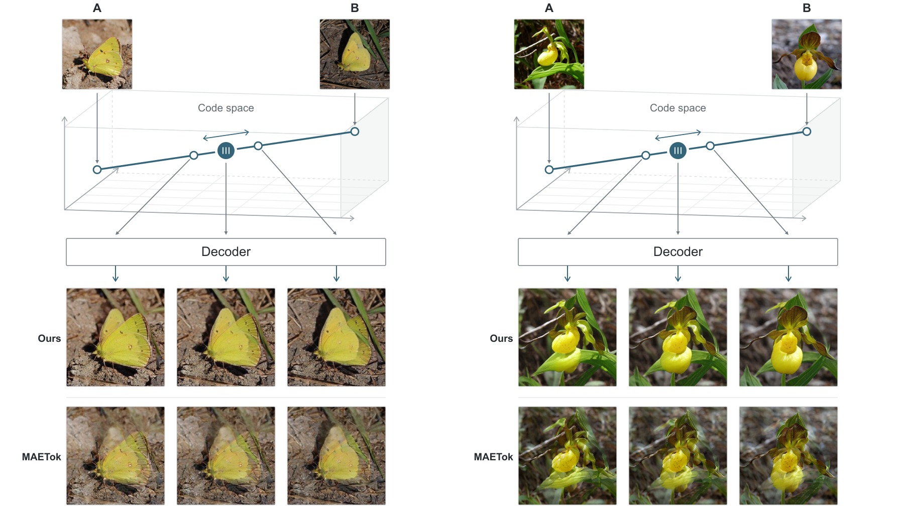

# InterpTok

<p align="center">
  <strong>Image Tokenizers Should Be Trained Between Images</strong>
</p>

<p align="center">
  <a href="https://arxiv.org/abs/2610.16759">📄 Paper</a> &nbsp;|&nbsp;
  <a href="https://graphics.cs.uni-tuebingen.de/papers/interptok/">🌐 Project Page</a> &nbsp;|&nbsp;
  <a href="https://huggingface.co/CGTuebingen/InterpTok-Models">🤗 Models</a>
</p>

<p align="center">
  
</p>

---

## Overview

A generator does not reproduce the codes of training images, and when a generated code lands outside what the decoder expects, the decoded image contains imperfections.
Generated codes lie between the training codes and resemble their mixture more than one of them plus noise.
InterpTok fine-tunes the tokenizer [MAETok](https://github.com/Hhhhhhao/continuous_tokenizer) on mixtures of the codes of two images.
An interpolation discriminator judges each decoded mixture beside its two source images, and a mixing ratio loss keeps the decoded mixture at the ratio of the mixture.
On ImageNet at 256 × 256, InterpTok keeps MAETok's reconstruction quality and lowers its interpolation FID from 14.42 to 4.30.
A SiT-B trained on its codes improves its generation FID without guidance from 11.61 to 8.48.

## Installation

```bash
git clone --recursive https://github.com/cgtuebingen/InterpTok
cd InterpTok

conda create -n interptok python=3.10 -y
conda activate interptok
pip install torch==2.6.0 torchvision==0.21.0 --index-url https://download.pytorch.org/whl/cu124
pip install -r requirements.txt
```

MAETok's code is included as the submodule `maetok`.
Training uses DINOv3, which is gated: accept its license at [facebook/dinov3-vitb16-pretrain-lvd1689m](https://huggingface.co/facebook/dinov3-vitb16-pretrain-lvd1689m) and log in with `hf auth login`.

## Pretrained Models

The weights are on [Hugging Face](https://huggingface.co/CGTuebingen/InterpTok-Models):

```bash
hf download CGTuebingen/InterpTok-Models --local-dir weights
```

| File | Model |
|---|---|
| `interptok_41k.safetensors` | InterpTok, the model of the paper, 41,000 steps |
| `interptok_82k.safetensors` | InterpTok trained further, to 82,000 steps |
| `interptok_decoder_41k.safetensors` | InterpTok's decoder on MAETok's frozen encoder, which decodes MAETok's codes and the samples of generators trained on them |
| `sit-b_interptok-41k/` | SiT-B trained for 400,000 steps on the codes of `interptok_41k` |
| `sit-b_maetok/` | SiT-B trained for 400,000 steps on MAETok's codes, the baseline of the paper |

Each tokenizer is a safetensors file of 217M parameters in float32: MAETok-B-128's encoder and a decoder of 18 blocks.
It encodes an image of 256 × 256 pixels into a code of 128 tokens with 32 values each.
Each SiT-B folder is an experiment of the code of Xu et al. below.
It holds `args.json`, the moving average of the weights in `checkpoints/0400000.pt`, and the configuration of its tokenizer.

## Usage

### Interpolate two images

```bash
python src/interpolate.py a.jpg b.jpg --weights weights/interptok_41k.safetensors --out a_to_b.png
```

This writes the two images with nine decoded codes on the straight line between them, as in Appendix A of the paper.
Without `--weights`, MAETok decodes the same line.

### In Python

With `src` on `PYTHONPATH`:

```python
import torch
from PIL import Image

import data
import model

tok = model.load("weights/interptok_41k.safetensors").cuda().eval()
images = [torch.from_numpy(data.center_crop(Image.open(f).convert("RGB"))) for f in ("a.jpg", "b.jpg")]
x = torch.stack(images).permute(0, 3, 1, 2).float().cuda() / 127.5 - 1    # (2, 3, 256, 256) in [-1, 1]

with torch.no_grad():
    z = model.encode(tok, x)                                                # codes, (2, 128, 32)
    mixture = model.decode(tok, 0.5 * z[:1] + 0.5 * z[1:])                  # (1, 3, 256, 256) in [-1, 1]
```

### Training

Training reads ImageNet-1k as `imagenet/train/<class>/<image>` and starts from MAETok's released weights.

```bash
torchrun --nproc_per_node 8 src/prepare.py --data imagenet/train --out prepared
torchrun --nproc_per_node 8 src/train.py configs/interptok.yaml
```

`prepare.py` runs once. For every training image it computes the DINOv3 feature and the 64 nearest neighbors, from which training pairs similar images, and it computes the feature statistics for the representation Fréchet loss.
[`configs/interptok.yaml`](configs/interptok.yaml) holds every setting of the paper's model and explains each one. To train a variant, copy it and change it. Its end lists the changes behind each run of Table 3.
On 8 A100 GPUs, the run takes 72 hours to 41,000 steps.
Every 1,000 steps it writes the moving average of the tokenizer, `interptok_<step>.safetensors`, and the checkpoint `last.pt`, from which `--resume` continues.
With `--wandb <project>`, it also logs its losses to [Weights & Biases](https://wandb.ai), after `pip install wandb`.

### Evaluation

```bash
python src/evaluate.py recon --weights weights/interptok_41k.safetensors --data imagenet/val
torchrun --nproc_per_node 4 src/evaluate.py probe --weights weights/interptok_41k.safetensors --train imagenet/train --val imagenet/val
torchrun --nproc_per_node 4 src/evaluate.py swap --weights weights/interptok_decoder_41k.safetensors --out samples.npz
```

- `recon` reports PSNR, SSIM in MAETok's convention, and LPIPS on AlexNet. It reads images in class folders. For MS-COCO, the paper takes the first 50,000 images of train2017 in sorted order; put them into one folder, such as `coco/all/`, and pass `--data coco`.
- `probe` trains a linear classifier on the codes with the recipe of MAE and prints its top-1 accuracy after each of the 90 epochs.
- `swap` samples the SiT-XL that MAETok released and decodes the samples with the given decoder. Its output is the input of the [ADM evaluator](https://github.com/openai/guided-diffusion/tree/main/evaluations).

The interpolation FID, the reconstruction FID and the SiT-B generators use the code of [Xu et al.](https://github.com/tongdaxu/Making-rFID-Predictive-of-Diffusion-gFID) at commit `94f4314`, with this repository's `src` on `PYTHONPATH`.
Its scripts load our tokenizer from a file `interptok.yaml`:

```yaml
target: model.Tokenizer
params:
  weights: /path/to/weights/interptok_41k.safetensors
```

```bash
# interpolation FID and reconstruction FID
accelerate launch evalvae.py --vae-config interptok.yaml --dataset imagenet/val --dataset-ref imagenet/train

# train a SiT-B on the codes
python preprocessing.py --imagenet-path imagenet/train --output-path imagenet256.h5 --resolution 256
accelerate launch train.py --model SiT-B/1D --vae-config interptok.yaml --data-dir imagenet256.h5 --exp-name interptok \
    --mixed-precision no --max-grad-norm 1e9

# sample it and compute the generation FID
torchrun --nproc_per_node 8 generate.py --exp-path exps/interptok --train-steps 400000 --mode sde --num-steps 250 \
    --cfg-scale 1.0 --fid-reference-file VIRTUAL_imagenet256_labeled.npz
```

To sample a released SiT-B instead, run `generate.py` inside the downloaded `weights` folder with `--exp-path sit-b_interptok-41k` or `--exp-path sit-b_maetok`. Each folder's configuration loads its tokenizer, `interptok_41k.safetensors` from the `weights` folder or MAETok from Hugging Face.

## Reproducing the Paper

| Result | How |
|---|---|
| Table 1, reconstruction FID and interpolation FID | `evalvae.py` of Xu et al. |
| Table 2, SiT-B | the released generators and `generate.py` of Xu et al., with `--num-steps` 250, 64, 32 and 16 |
| Table 2, MAETok's SiT-XL with our decoder | `src/evaluate.py swap` with `--steps` 250, 64, 32 and 16, then the ADM evaluator |
| Table 3, ablations | `src/train.py` with the changes listed at the end of `configs/interptok.yaml` |
| Table 3, linear probe | `src/evaluate.py probe` |
| Table 11, PSNR, SSIM and LPIPS | `src/evaluate.py recon` |
| Figures 1 and 4 to 16, interpolations | `src/interpolate.py` |

## Citation

If you find this work useful, please cite:

```bibtex
@article{beisswenger2026interptok,
  title   = {Image Tokenizers Should Be Trained Between Images},
  author  = {Bei{\ss}wenger, Ole and Dihlmann, Jan-Niklas and Lensch, Hendrik},
  journal = {arXiv preprint arXiv:2610.16759},
  year    = {2026}
}
```

## License

The code and the weights are released under the [Apache License 2.0](LICENSE).

## Acknowledgments

This project builds upon:
- [MAETok](https://github.com/Hhhhhhao/continuous_tokenizer), the tokenizer InterpTok fine-tunes
- [Making rFID Predictive of Diffusion gFID](https://github.com/tongdaxu/Making-rFID-Predictive-of-Diffusion-gFID), the interpolation FID and the SiT-B training
- [DINO](https://github.com/facebookresearch/dino) and [DINOv3](https://github.com/facebookresearch/dinov3), the discriminator's backbone and the teacher of the alignment losses
- [DiffAugment](https://github.com/mit-han-lab/data-efficient-gans) and [LPIPS](https://github.com/richzhang/PerceptualSimilarity)
